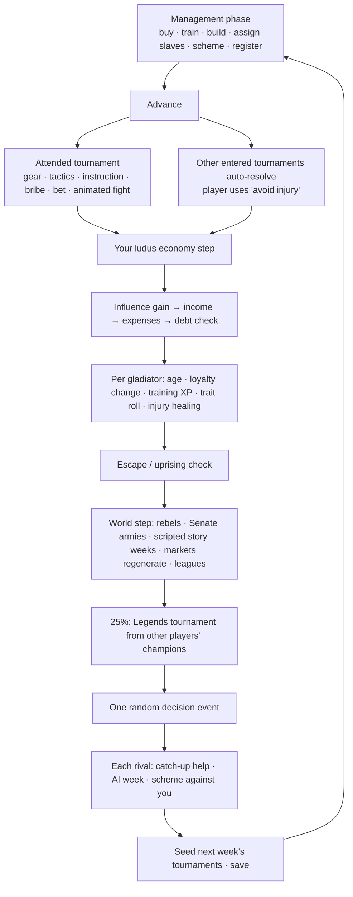

# Gladiator Manager: Complete Analysis

*Gladiator Manager by Renegade Games: what it is, its story, how every system works, its business model and technology, how it was received, its bugs, and what its design teaches.*

This analysis is based on **Android build 3.16.2b (version code 898, September/October 2026)**. That build was downloaded from a public mirror and decompiled, and **all 533 game classes (~120,000 lines) were read**. The findings were cross-checked against the in-game wiki and string tables, the store listings, ~380 Android changelog entries, press reviews, the developer's public stats API, and a sample of 2,703 Google Play reviews.

Formulas and numbers below come from the code. **[quirk]** marks behaviour that looks unintended. **[?]** marks a reading that could not be fully confirmed because the decompiler mangled that method.

| Deep-dive document | Covers |
|---|---|
| [01 — Combat engine](01-combat.md) | Attributes, derived stats, round loop, hit/crit/damage/armor math, 31 techniques, status effects, tricks, surrender, injuries and death, beasts, mounts, classes, origins, instructions, rewards |
| [02 — Items, buildings, economy](02-items-economy.md) | Every weapon, armor piece, item, mount and legendary; forge and workshop; 17 buildings; slaves; weekly finances; debt; markets; rival trading; auctions |
| [03 — Loop, progression, rivals, tournaments, ascension](03-loop-progression.md) | Exact weekly resolution order; aging; XP and training; 146 traits; rival personalities and AI; tournament calendar and prizes; leagues; the 16 Ascension levels; objectives; achievements |
| [04 — Story, events, quests](04-story-events.md) | Premise, cast, the Spartacus arc, 19 storylines, ~60 random decisions, quests and adventures, rebellion, underground pits, the endgame narrative |
| [05 — Intrigue, influence, loyalty](05-intrigue-influence-loyalty.md) | Six intrigue actions with formulas; pre-battle bribes; betting; influence tree; Senate and Consul elections; laws; loyalty formula; escapes and uprisings; security |
| [06 — Screens, monetization, tech](06-ui-monetization-tech.md) | 76 screens and the UX flow; tutorial; animation and audio; the gem economy and all 56 upgrades; tech stack; cloud saves; online features; accessibility |
| [07 — History, reception, community](07-history-reception-community.md) | Timeline 2019–2026, press reviews, a 2,703-review sentiment study, leaderboards, Discord, sister games |

---

## 1. At a glance

| | |
|---|---|
| **What** | A turn-based ludus-management sim in late-Republic Rome. You train gladiators, and their fights are auto-resolved. Around that you run an estate economy, scheme against rival houses, play Senate politics and deal with a slave rebellion led by Spartacus. Runs are roguelite and lead into a 16-level "Ascension" New Game+ ladder. |
| **Who** | Renegade Games: solo developer **René Slump** (Netherlands; design and code), with pixel art by **Sim Kaart**. |
| **Platforms** | Android (since **7 Nov 2020**), iOS/iPadOS/Apple-silicon Mac/visionOS (since **13 Jun 2023**), and Windows through Google Play Games. |
| **Scale** | 1M+ Play installs (≈1.8M). 4.27★ from 13K ratings on Play and 4.3★ on iOS. ~10K Discord members. 381 Android builds shipped since May 2021. |
| **Business model** | Free. **No ads, energy, gacha or subscriptions.** One premium currency, gems, buys 56 permanent unlocks (7,650 gems in total). Achievements pay out up to ~5,200 gems for free. IAP: Pouch of 500 gems for $3.99, Chest of 1,500 gems for $7.99. |
| **Tech** | Native Android in Java with classic Views; JSON saves; Firebase Auth and Firestore as the whole backend; Play Billing 8. 13 languages. |
| **Press** | TouchArcade 4/5 ("Only a Famous Death Will Do"), Hardcore Droid 3.5 ("Is it Hardcore? Yes"). |
| **Sister games** | *Imperium: Rome* (2025, legion merge-autobattler) and *Castle Away* (Steam, 2027, floating-castle roguelite). |

---

## 2. What kind of game it is

You are a **lanista**, the owner of a gladiator school. You fled "an incident in your hometown" and founded "a modest ludus" in **Capua**, "the home of gladiatorial battles". You start with **1,000 denarii** (800 on Hard), one or two slaves, an empty residence and **no gladiators**. Each turn is one **week**, played in two phases:

1. **Management.** Buy and sell gladiators, beasts and gear. Set training and the doctore (head trainer). Spend attribute and technique points. Assign slaves to mining, entertainment, security or spying. Build, spend influence, send agents to scheme against rivals, answer messages and register for tournaments.
2. **Combat preparation and resolution.** For the one tournament you attend, choose gear, technique order and an instruction for each round. Optionally bribe the guards or bet, then watch the animated auto-battle. Every other tournament you entered resolves automatically.

The week then resolves: income and upkeep, aging, training XP, loyalty, escape attempts, rival AI turns, a random decision event, story beats, rebel activity and next week's tournaments.

The store describes three arcs:
- **Setup** (weeks 1–50): Lunar league, rookie events, first buildings, the Spartacus story begins.
- **Mid-game** (weeks 50–150): Bacchus, Jupiter and Vulcan leagues; Senate politics; the rebel war; quests.
- **Late game** (150+): leaderboard chasing, or Ascension into god-modified reruns.

There is **no victory screen**. The game ends when you lose, through debt, a slave uprising, a rebel sack or a rival raid. Otherwise you keep going: chase the seasonal "Imperium" leaderboard (influence × 1 / 1.5 / 3 by difficulty) or win the Ascension tournament and start again harder.

The developer names *Spartacus* (the Starz series), *Gladiator* and *Football Manager* as inspirations. Players compare it to *Domina*, *Swords & Sandals* and *King of Dragon Pass*. Its defining quality is that these systems **interact and produce stories**. TouchArcade's review opens with exactly that: the reviewer had Flamma's family killed to "keep him focused", and Flamma escaped, raised barbarians, burned the estate and put the reviewer's head on a pike. Every step of that story is a mechanic described below.

---

## 3. The story and the world

**Setting.** The late Roman Republic around the Third Servile War. It mixes history with the *Spartacus* TV series, HBO's *Rome* and Greco-Roman myth. The tone is darkly comic: discipline is "Cut his eye out!", traitors get fed to crocodiles, and failure means walking home in a loincloth.

**Rival houses** (all AI, each with a five-axis personality):

| House | Notes |
|---|---|
| **Batiatus** | Greedy and treacherous. He owns Gannicus, Oenomaus (his doctore) and later Spartacus. |
| **Solonius** | Asks you to throw your very first fight. |
| **Decimus** | The honest one. |
| **Magnus** | Erratic. |
| **Vettius** | Hidden. He runs the intrigue market and fields the giant **Gigantus**. |
| **Caesar** | Arrives in week 25 (Hard 20, Nightmare 12). |
| **Crassus** | "The richest man of Rome". Appears in Nightmare or as a replacement house. |
| **Hannibal Barca** | Brought back at Ascension 16. |
| **Varro** | Added on 21 Oct 2026 (iOS 3.5 / Android 3.16.3), after the build analysed here. |

Randomly named houses refill the field to four rivals every six weeks.

**Act I.** In week 1, Solonius proposes "quid pro quo": lose to his gladiator in "Rome's finest" and he slips you 300 denarii. The developer recommends taking the deal to fund week 2.

**The Spartacus arc** (Normal week / Hard week; verified in bytecode):

| Normal | Hard | Beat |
|---|---|---|
| 15 | 10 | Batiatus acquires the Thracian slave Spartacus. |
| 20 | 18 | Spartacus' family is butchered (−20 loyalty, *Lost Family*). |
| 28 | 24 | Batiatus humiliates and pimps out his gladiators (Spartacus −30 loyalty). The **SpartacusEscape** storyline starts: Spartacus whispers from an alley, asks you to set fire to Batiatus's estate (a Sabotage action), and promises a share of the loot. |
| 35 | 30 | Spartacus plots revolt. |

Once he is free (through the ordinary loyalty and escape system), he leads a **rebel army** of escaped gladiators and slaves:
- It gathers plunder and raids ludi, including yours.
- Above 3,500 plunder it forges the legendary sword **Libertas**.
- The Senate sends armies against it.
- Later Spartacus offers to raze a rival of your choice for 500 denarii.

You end the rebellion by mounting **military expeditions**. These need influence; militia size is set by money, slaves and political rank, and you choose tactics. The arc closes with "His lifeless corpse has been nailed on a cross along the Appian way."

**Quests and legendary relics.** Questlines are driven by stories, events and adventures:

| Questline | Reward |
|---|---|
| The Egyptian **Tomb of Necho II**: a Sphinx riddle (answer: *man*), then a mummy fight | *Black Death*, an obsidian palm axe |
| **Restoration of Troy**: escort Hector, then a Trojan tournament against Myrmidons and "Achilles" | *Hand of Midas* and *Achilles' Spear* |
| **Quest for Crocea Mors** in Britannia: eight stat-checked approaches, including counterfeit gold, out-drinking guards and abducting a child | Caesar's sword |
| **Mythical Romulus** I–III | The *Founder's Axe* |
| Others | Hannibal's regalia, helmet and sandals; Alexander's armour (beat Vorenus & Pullo); Pericles' helmet; the Bow of Apollo; the Shield of Leonidas at auction; the Mysterious Hag's egg, which hatches a **gryphon** in battle |
| **Taking a Closer Look** (newest) | The *Looking Glass*, which unlocks inspection of individual battle logs |

**Endgame.** Three milestones open the **Ascension tournament**:
- **4 league titles** (election to the Senate counts as one; 5 titles from Ascension 11);
- **the rebellion crushed**;
- a **Pantheum shrine to Janus in Ariminium**. Ariminium is unlocked by a "sacred ruins" event that needs >1,000 denarii, >200 influence, Senate standing, >10 slaves and spies.

The tournament is a gauntlet of the gods' champions. Winning it lets your champion **reincarnate** into a new run under the next god's curse:

| # | Level | # | Level |
|---|---|---|---|
| 1 | Wealth of Saturn | 9 | Judgement of Jupiter |
| 2 | Vulcan's Forging Destiny | 10 | Vitality of Juno |
| 3 | Prowess of Sol | 11 | Violence of Mars |
| 4 | Wrath of Neptune | 12 | Apollo's Prophecy |
| 5 | Wisdom of Minerva | 13 | Creation of Gaia |
| 6 | Desire of Venus | 14 | Hyperion's Heights |
| 7 | Diana's Hunt | 15 | Depths of Tartarus |
| 8 | Pluto's killing | 16 | Reaping of Cronus |

A side chain from the **Pythia of Delphi** asks you to raise a blind boy, **Neokoros**, into a champion, then demands the sacrifice of 100 slaves and 10,000 denarii. It ends with harpies and a level-40 **Cyclops** and skips you one Ascension level.

Full narrative detail, with every event's choices and payouts, is in [04](04-story-events.md).

---

## 4. The week, step by step

The resolution order below is taken from `WeekResolver` and `World.AppendWeek` and checked against raw bytecode ([03 §1](03-loop-progression.md)):

Key properties of the loop:
- **Only the first tournament you join each week is played live.** The rest are auto-resolved, and your fighters use the "avoid injury" instruction.
- **Entry fees are never charged** [quirk]. The fee only scales the prize.
- **Everything ages.** Gladiators age 1–2 weeks per turn (always 2 in Ascension runs). Peak years are **18–27**: from 28, Initiative and XP gain decline, and by 40 Strength ×0.8, Initiative ×0.6 and XP ×0.4. Nobody dies of old age; they just become useless.
- **Debt is a spiral, not a wall.** Each negative week adds a permanent weekly penalty and cuts influence. Two bankrupt weeks in a row with no slaves left to sell ends the run (`DebtPileUp`).

---

## 5. How every system works

### 5.1 Gladiators

| Attribute | What it does |
|---|---|
| **Strength** | Base damage of every attack; stun, disarm and bleed resistance |
| **Initiative** | Turn order, hit, crit and dodge; resistance to blind and disarm. "The most popular build" per the developer. |
| **Cunning** | Dirty tricks, smart targeting, status power and resistance; doctore quality; trait learning |
| **Health** | HP; **each point spent gives +5 HP** |
| **Loyalty** | 0–100, starts at 80. It matters mostly outside combat. |

**Leveling.**
- Total XP to reach level N is **50·N·(N−1)**: L2 100, L5 1,000, L10 4,500, L20 19,000.
- Each level gives +1 attribute point.
- Every 3rd level gives +1 technique point, used to learn or rank up a technique.
- There is **no hidden potential stat**: growth comes from levels, traits, class levels and training.

**Training.** Each week a gladiator gets:
- `base 10 (+2 Celtic) + doctore term`, plus facility bonus;
- × Light 0.75 / Standard 1 / Intense 1.5 / Technique 0.5;
- plus paid trainers: Bestiarii (25/wk), Spartan (35/wk), Weapons Master (50/wk).

Intense training raises injury risk (4 vs 2). Technique training can teach rare techniques. A good doctore (high level and Cunning, ideally with the *Doctore* trait) roughly doubles everyone's weekly XP.

**Classes.** There are eight: Murmillo, Retiarius, Hoplomachus, Dimachaerus, Barbarus, and three gem-unlocked ones (Sagittarius, Cestarius, Lorarius). Each has a preferred weapon, techniques and traits. The combat bonus is small:
- +3 accuracy with the preferred weapon;
- ×1.1 damage on preferred techniques.

**The hidden lever is XP.** Once classed, a gladiator's *proficiency %* multiplies **all** XP he earns:

> proficiency% = 15×(preferred techniques known + preferred traits owned) + 10 + level + class level ± origin modifiers, clamped to 0–100.

A freshly classed gladiator with nothing matching therefore earns roughly **20 % XP**. An unclassed gladiator always earns 100 %. Class only once he already owns ~5 matching techniques and traits.

**Origins** (nine, one per gladiator). Each has a basic bonus and an "advanced" bonus unlocked by fame and a *Sand* item:

| Origin | Basic | Advanced |
|---|---|---|
| Gaul | +7 status resistance | +2 to all stats every hit taken |
| Roman | Loyalty and proficiency bonuses | Every weapon proficiency applies to every weapon |
| Greek | +1 armour | Crit chance + % of HP missing |
| Iberian | +1 reach | Not implemented [quirk] |
| Punic | Faster trait gain | +1 damage per 2 traits |
| Thracian | +25 % training | Stacking damage and hit per attack |
| Briton | +10 crit | Heal on crit |
| Egyptian | Double divine favour | Favour added to damage |
| Parthian | Class mastery | Mount bonuses doubled |

**Traits.** There are 146, gained from:
- generation (1 random);
- a weekly roll (Cunning-driven, doubled for Greek heritage);
- training, tournaments (pit and league tiers), events, injuries and beast bonding.

Many change stats or loyalty. A few transform play: *Lycanthropy* (a werewolf at the full moon), *Blind*, *Psychopath*, *Titanic Strength* (one-handed great weapons). The full table is in [03 §4](03-loop-progression.md).

### 5.2 Combat

Battles are **auto-resolved simulations of 6 rounds** (8 for events), up to **3v3**. You influence them through:
- **gear** and **technique priority** (with the Tactician upgrade);
- **instructions**: default, all-out, kill, avoid injury, throw;
- **cheats**.

Core math ([01](01-combat.md)):
- **Turn order.** Sort once by `Initiative + 5×weapon reach + favour`. Reach matters enormously: a Pilum has reach 8, a bow 10.
- **Hit total:**

  > T = 45 + rand(30) + 1.5×(I − 7/12·target I) + accuracy bonuses − dodge

  - T below 30 is a miss.
  - T of 31–39 is bumped to 45 [quirk].
  - Below 40 is a **glancing blow**: Strength's contribution drops by 75 %.
- **Crit:** `T + crit bonus + rand(30) ≥ 110`. On normal attacks a **crit does not add Strength** [quirk]. Its value is mostly that it can't glance, and techniques do add Strength on a crit.
- **Damage:** `(Str + bonus)×(1 + W/10) + W`, where W is the weapon's damage points.
- **Armour:** reduction = **A / √(A² + 900)**:

  | Armour | Reduction |
  |---|---|
  | 10 | 32 % |
  | 20 | 55 % |
  | 30 | 71 % |
  | 50 | 86 % |

  Returns diminish smoothly. The UI elsewhere shows `A/(A+5)` instead [quirk].
- **31 techniques.** Smash, Lunge, Kick, Sunder, Throw Sand, Parry, Headbutt, Feint, Charge, Decimate, Gouge, Rally, Disarm, Rampage, plus rare and upgrade ones: Execute (chains on kills), Cheap Shot, Cleave, Impale, Hail of Arrows, Thunderstrike, Fireball, Hurricane and more. Each has a stat requirement, a cooldown of 1–4 and a priority formula.
- **Status effects.** Blind, stun, daze, disarm, fear, enrage, ensnare (nets), bleed, sunder and more, each with its own resistance formula.
- **One dirty trick per battle.** A battle-wide limit shared by both sides: enrage, disarm or blind via Cunning.
- **Ending a fight.** Knockout below 1 HP. Surrender depends on instruction and loyalty. At time-out the side with more fighters standing wins; otherwise the crowd (total HP, *Showman* +50) decides.

**Death and injury.**
- After a fight, a loser rolls `rand(11) + modifier`. Above 10 means injury: flesh wound 2 weeks, broken bones 3, severe 4, multiple 5. A roll of 15 means **death**.
- Typical odds for a loser:

  | Situation | Death chance |
  |---|---|
  | Plain knockout | ≈ 4.5 % |
  | Knocked out by an opponent on "kill" | ≈ 18 % |
  | Surrendered | 0 |

- Winners can be injured but never die.
- **Bandages** downgrade one fresh injury, including death.
- Severe injuries have a 50 % chance of leaving a permanent wound trait (crippled, bum leg, partial blindness, …). Surgery can remove it but can kill.

### 5.3 Beasts and mounts

**Beasts** are buyable or event-given fighters with fixed stats that level up and never surrender:
- wolves, dire wolves, lions, bears, crocodiles;
- rhinos and elephants (gem-gated), gorillas;
- mythical foes: harpies, minotaur, medusa, cyclops, manticore, hydra, wraith, gryphon.

Two un-tamed *Alpha* beasts fight each other. Treats at 10 denarii build the *Good Boy* / *Best Boy* traits.

**Mounts** need Stables:
- **Numidian** and **Celtic** horses, both with −6 Initiative.
- **Elephants**, which frighten enemy riders.
- **Gryphons**, which lend the Hurricane technique to a "worthy" rider.
- The legendary **Enbarr**, won in a joust.

Mounts add Strength, HP, block and **reach**; reach feeds turn order at ×5.

### 5.4 Equipment

- **18 weapon types** in seven families (sword, spear, dagger, axe, bow/javelin, fist, whip) and **23 armour, helmet, shield and net types**.
- Six qualities: Shoddy, Old, Regular, Quality, Master-crafted, Legendary.
- Every price derives from one **worth** value: base × quality multiplier, ×0.5 to ×9 for weapons and up to ×11 for armour.
  - Buy at worth.
  - Sell gear at worth/2.
  - Sell gladiators at worth×3, capped at 700.
- **Augments:** Lunar, Solar, Bloody (lifesteal), Precision, Blessed (favour), Reinforced, Fortified, Barded, TimeWarped.
- **Sets:** Roman Legionary (+2 block, +2 damage resistance), Hannibal, Cataphract.
- **About 20 legendary relics**, each tied to a quest ([02 §3.4, §4.4](02-items-economy.md)).
- **Forge** (Blacksmith 1/2/3 caps quality at Regular / Quality / Master-crafted): buy new gear at 80/75/65 % of worth, or **reforge** an item one tier up. A reforge succeeds if `rand(10) + blacksmith level ≥ quality index + 1`; a failed reforge keeps the money.
- **Workshop:** crafts consumables (bandages, antidotes, amulets, Silphium).

### 5.5 Estate, slaves and money

**Slaves** cost 80–120 each and 2/week upkeep (4/week beyond your beds). They do four jobs:

| Job | Effect per week |
|---|---|
| **Mining** | **10 denarii per miner** (12/15 with mine upgrades). This is the backbone of the economy. |
| **Entertainment** | Influence: E if E ≤ 10, E/2+8 up to 100, E/4+48 above. Loyalty for all gladiators: E/2+2, or E/3+6 at 20+. |
| **Security** | Blocks escapes, intrigue and raids, on diminishing-returns curves. |
| **Spies** | Need Residence level 2. Boost intrigue, improve market quality, and reveal hidden stats of market gladiators. They count with a one-week lag. |

**Buildings.**
- **17 buildings in three locations:** Capua (Residence, Training Field, Mine, Blacksmith, Medicus, Wall, Stables, Temple of Pluto, Library), Ariminium (Camp, Shrine, Workshop, Guard Tower, Aqueduct) and Rome (Mansion, Tavern, Bath House).
- **One build per week**, instant, with no upkeep.
- Big earners: Aqueduct +100 denarii and +30 influence a week; Tavern +100 and +10. Full table in [02 §8](02-items-economy.md).

**Gladiator upkeep.**
- 5/week each within training capacity (3 base + Training Field), 10/week beyond.
- A level surcharge applies: a level-10 gladiator costs +44/week. Veterans become expensive.

**Weekly balance** = mining + buildings + Senate stipend (+50) + recurring modifiers − slave upkeep − gladiator upkeep. Many events, loans and "investments" permanently change your weekly cash flow. Inflation takes −1/week every 12 weeks.

### 5.6 Markets and trading

- Every week the gladiator, beast, weapon, equipment, mount and item markets **regenerate**. Their quality scales with the week number and your spies.
- **Week 1 always offers the same three starters:**

  | Starter | Price | Strength | Cunning | Trait |
  |---|---|---|---|---|
  | Flamma | 300 | | | Glory Seeker |
  | Tetraites | 350 | 8 | | Agile |
  | Carpophorus | 400 | | 8 | Beast Tamer (bonus against beasts) |

  The wolf **Aello** (Initiative 20) is also on sale for 100.
- **Price of a market gladiator:** `10×(Str+Cun+Ini) + maxHP + trait term + 20×(level−1) + 10`.
- Each week you can make one offer per rival for their gladiators, beasts or gear. Rivals value fighters at `15×(stats) + 3×HP + 30×level + 2×fame`, adjusted by their personality, their opinion of you and how badly they need cash.
- **Auctions** (an art collector's event) and a **Traveling Merchant** (gem upgrade) sell unique items.

### 5.7 Tournaments, pits and leagues

**Calendar.**
- Weekly underground pits.
- Rookie "Initium" every 3 weeks; Junior "Iunior Victores" (under 17) every 4.
- Pankration (unarmed) every 8.
- Scripted early events: Rome's finest (week 1), Hippodrome (week 3), Bestiarii exhibition, Gigantus (week 6), Imperator's Triumph (a 3v3×16 bracket).
- Rival-organised tournaments, and ones you organise yourself for 300 denarii; you earn by attendance and weather.

**Prize.** `fee × contestants / 2` (−100 if over 500), plus 25 per pit bonus round. Winner's influence is contestants + teams.

**Underground pits.** Win the bracket, then **keep fighting bonus rounds**, or retire with your earnings:

| Round | Opponent |
|---|---|
| 1 | Hungry wolf |
| 8 | **the Colossus** |
| 9–10 | Equites |
| 12 | Provocator |
| 13 | **Tigris** (Legendary Pit Fights upgrade) |

Pit traits climb one tier per pit event: Pit Fighter → Pit Champion → Giant Slayer → Pit Legend → Bane of Tigris.

**Leagues.** Each runs a season of events with points 4/2/1 per gladiator (doubled in finales) and pays a pool plus a unique prize to the top 3:

| League | When | Pool (denarii) | Unique prizes |
|---|---|---|---|
| Lunar | weeks 0–13 | 700 | Lunar gladii |
| Solar | from week 20 | 1,000 | Solar xiphoi |
| Bacchus (gem) | ≥ week 50 | 1,500 | Thyrsus |
| Jupiter | ≥ week 85 | 2,000 | Ancile |
| Vulcan (gem) | ≥ week 120 | 3,000 | Vulcan cuirasses |
| Annum | every ~16 weeks after week 160 | 2,000 | Bloody weapons |

**Legends tournaments.** About a 25 % chance per week. They fill a bracket with **real champions uploaded by other players**, tiered Bronze → Silver → Gold → Diamond. This is the game's clever asynchronous PvP.

### 5.8 Rival AI

Rivals follow the same rules as you ("but they do start with a bit more workers"). Their behaviour is driven by personality axes:
- **Financial:** Greedy, Spender, Balanced or Crazy.
- **Arena:** Conservative, Balanced or RiskTaker. This decides when they quit pit fights.
- **Honesty:** Honest 0, Neutral 1, Dishonest 3, Treacherous 5. This sets their likelihood to cheat.
- **Training regime** and **class mindset**.
- **Preferences:** Cheap, Talented, Established, Quick, Strong, Cunning or Mythic.

Each AI week they:
- operate on their wounded;
- reward unhappy gladiators;
- take one emergency loan when broke;
- build, in the order stables → training ground → mine → wall → medicus → residence → blacksmith;
- buy slaves, recruit, poach, reforge and sell surplus;
- organise tournaments and invest in mines;
- start storylines with you depending on **opinion**, which starts at 50.

A hidden **catch-up system** quietly feeds rivals extra slaves, mining bonuses and the odd free gladiator. On Nightmare it also adds weekly XP.

A rival house dies from:
- two bankrupt weeks;
- a slave uprising;
- a rebel sack;
- your **Raid**, a real 2v3 battle that needs the *Veil of Night* perk.

### 5.9 Intrigue and cheating

**Intrigue** ([05 §1](05-intrigue-influence-loyalty.md)) costs no money. It costs **one gladiator's week**: he becomes an agent and cannot fight. Six actions exist:

| Action | Effect |
|---|---|
| **Assassinate** | Injures or kills a rival gladiator |
| **Poison** | Makes the target *Ill* or kills him (antidotes counter it) |
| **Persuade** | ~20 % of successes turn the target into **your spy**. He then **throws every fight against you**. |
| **Steal** | Gold, or a weapon or armour piece on a critical success |
| **Sabotage** | Destroys building levels |
| **Raid** | The 2v3 battle described above |

- **Success:** `chance + scenario + rand(101) ≥ 100`. The chance comes from stat gaps, traits, spies (`clamp(2×your spies − theirs, ±15)`) and the target's security.
- Before resolving, you see a random **scenario** (a raven flying left, a goat sacrifice, a party next door, a sprained ankle, …) and choose to proceed or retreat.
- Failure can injure or kill your agent. Discovery hurts opinion.

**Rivals scheme against you.** Each rival rolls `rand(120) − opinion/2` every week:
- **Persuade or poison at 85+**, and only if **your influence exceeds theirs**.
- Steal at 95+ and sabotage at 105+, only from Ascension 6 or on Nightmare.
- **Assassination at 120+**, which is effectively impossible unless opinion has gone negative.

**Pre-battle bribes:**

| Bribe | Cost | Effect |
|---|---|---|
| Poisoned weapons | 30 per own gladiator | Poison damage on hits |
| Enchain opponents | 20 per enemy | **−⅔ Initiative** for the whole fight, devastating given how Initiative drives everything |
| Release a wild beast | 80 (gem upgrade) | A beast joins your side |
| Replace the guards | 25 (Senators only) | Cancels the opponent's cheat |

The AI cheats when `rand(8) + likelihood > 9`, and the battle screen warns you. Bribe costs double from Ascension 5.

### 5.10 Influence and politics

**Influence** comes from entertainment slaves, buildings, wins, events and Senate status; Roman heritage adds +20 %. It is **reserved, not spent**, to unlock a 3×5 **opportunity tree**. Unlocks cost 20, 40, 80, 160, 300, 500 … up to 60,000, depending on how many you already own.

| Path | Unlocks |
|---|---|
| **Lanista** | Public Training Sessions income; Bribe General (offers prisoners such as Crixus or Maximus); The Organizer; Class/Weighted Training; **Imperator** (expeditions) |
| **Senator** (gem upgrade) | Lobby the Senate; Market Connections / Power Begets Power / Socializer; **Elected Senator**; Princeps Senatus; **Consul** |
| **Trickster** | Loans; Informants / Forbidden Contraband; Gambler (betting); Bacchus Patron; **Veil of Night** (Raid) |

**Elections.**
- A campaign costs 400 denarii (Senate) or 1,000 (Consul), needs ≥ 200 influence and lasts 5 weeks. **100 votes win.**
- Votes come from your weekly influence gain (a lookup table worth −4 to +17 votes), a random 1–3, a smear campaign (8 votes/week for 200 denarii) and campaigning gladiators (up to 10/week).
- **Senators** get +50 denarii and +5 influence a week and Senate-only events. **Consuls** get lictor bodyguards and can punish captured agents.
- Only **one law** exists: Public Funding, 500 denarii to every ludus every 4 weeks.

### 5.11 Loyalty, escapes and the rebellion

**Weekly loyalty change** = entertainment term + security-slave term + influence tier (−2 to +12) **− (level − 1)** + traits + origin×heritage + legend clashes + gear happiness + Ascension penalties.

- The level term means **veterans lose loyalty fastest**.
- Famous gladiators also expect expensive gear.
- Spartacus, Crixus, Oenomaus and Gannicus dislike sharing a ludus.

**Escape check.** A gladiator **stays if `rand(40) + 10 ≤ loyalty`**:

| Loyalty | Outcome |
|---|---|
| ≥ 49 | Never rebels |
| 30 | 47.5 % chance to try each week |
| < 10 | Always tries |

Rebels then attempt one of three escapes, by count:
- **1** gladiator: a solo escape;
- **2–3**: a coordinated escape;
- **4 or more**: an **uprising**. If both its Cunning and brute-force rolls beat your security, it **burns the ludus down**, and the game is over.

Escapees join Spartacus's army.

**Fixes.**
- Reward a gladiator: +40 loyalty for 50×(level/2+1) denarii, once every 10 weeks.
- Adopt one heir.
- Entertainment and a Tavern.
- Influence.
- Security slaves.

**Rebel raids** on your ludus offer three choices:
- **Fight:** your champion against theirs.
- **Pay:** 25 denarii × army size.
- **Hide:** lose property, slaves or a wall.

Losing badly with no fighters left means "your head has been put on a pike at the gate". Raids can be disabled at game start.

### 5.12 Events, quests and adventures

- **One random decision per week**, drawn from about 60 eligible events. Recent ones are excluded and repeats are prevented. Examples:
  - a gladiator requests the *rudis* (freedom) after 10 wins;
  - a suspected spy;
  - mine collapse, plague, flood, drought;
  - a tax collector, an orphanage sale, a beggar who might leave a cursed **Dark Blade**;
  - a jousting challenge, a Celtic grave-robbing map;
  - Senate proposals.
- **Adventures** send a gladiator away for 2–4 weeks to a scripted fight, with traits, items, gold and influence as rewards.
- **Status gates** open better options as you rise: Senate connections, Consul powers, crocodiles to feed people to.

### 5.13 Difficulty and Ascension

**Difficulty modes:**

| Mode | Unlock | Effects |
|---|---|---|
| Normal | — | Allows save-scumming. |
| **Hard** | 300 gems | 800 starting gold; richer, buffed rivals; faster rebels; an earlier timeline; score ×1.5 |
| **Nightmare** | 200 gems, after Ascension 5 on Hard | Rivals gain weekly XP; Caesar arrives in week 12 and Crassus in week 20; prize cuts; more intrigue; no save-scumming; score ×3 |

- **Sandbox** gives +5,000 gold and disables raids and betrayals. It also disables achievements and leaderboards.

**Ascension.**
- **Levels stack.** Level L applies its own curse plus all lower ones (confirmed: the code's switch statements fall through). Examples:
  - Saturn: you age 2 weeks per turn and lose 5 denarii a week.
  - Venus: loyalty bleeds −1 to −3 a week, and rivals may sabotage and steal.
  - Pluto: your best fighter is disfigured.
  - Jupiter: −1 influence a week.
  - Tartarus: werewolves and underworld raids.
  - Cronus: all your techniques start every battle on cooldown, and Hannibal returns.
- **Each level adds a god's chosen champion** to a rival or to the rebels, such as Hephaestus, Poseidon, Ares, Jove, Draugluin and Perseus.
- **The Ascension gauntlet** has L+2 bonus rounds, ending with harpies, a Manticore, a Hydra and a Wraith at the Titan levels.
- **Your champion carries over.** Reincarnated young (age 15, base 8/8/30/8, first technique, 1–2 traits) or old (all stats, aged ~55, starts ill). Reincarnation levels stack permanent bonuses.
- Normal, Hard and Nightmare track **separate Ascension ladders**. The highest seen on the public leaderboard is 16.

### 5.14 Online features

- **Seasonal highscores.** Six seasons since 2021. The score is "Imperium" = influence × mode multiplier.
- **Hall of Fame.** Snapshots of your most famous gladiator feed other players' Legends tournaments and a local 1v1 "Challenge".
- **Friends** by code.
- **Real-time multiplayer** (beta): simultaneous turns, the host resolves, a version gate.
- **Cloud Sync** (50-gem upgrade): one game at a time.

Everything runs on Firebase. The simulation itself is client-side.

---

## 6. Monetization

| | |
|---|---|
| Currency | **Gems** only. They can't be converted to in-game gold. |
| IAP | **Pouch** 500 gems for $3.99; **Chest** 1,500 for $7.99 (50 % better value). Both are consumables. |
| Free gems | **65 achievements** at 50 or 100 gems each, 5,900 in total. About 700 of those come from retired season and beta achievements, so **~5,200 are earnable**. |
| Catalogue | **56 upgrades, 7,650 gems in total**. Greek heritage 150; Egyptian 200 (needs Greek); Hard 300; Nightmare 200; Senator tree 250; War Elephants 250; extra weapons, armour, buildings, leagues, quest chains, classes and techniques at 50–200. |
| Gap | A perfect free player is ~2,450 gems short of everything. Completion costs **≈ $16** after maximum grinding, or **≈ $41** bought from zero. |
| Not present | Ads, energy, timers, loot boxes, subscriptions, pay-for-power currency conversion. |
| Upsell surfaces | Locked gear shows a lock icon in markets; locked leagues and buildings redirect to the shop; a "Toss a coin to your dev!" tooltip. |
| Crediting | Client-side. No server receipt validation is visible. |

Players read this model as **unusually ethical**: "no ads / not pay-to-win" is the theme with the highest average rating in the review sample, 4.81★. The recurring complaints are that Hard mode, save slots and cloud sync are paywalled quality-of-life features, and that locked items clutter the gear lists. Details are in [06 §2](06-ui-monetization-tech.md).

---

## 7. Technology

- **Code.** Java (no Kotlin), classic Android Views and XML layouts, **76 activities**, all landscape. One global application object holds three JSON-serialised state graphs (`Player`, `World`, `OpponentData`), saved per slot.
- **Backend.** Firebase Auth (Google sign-in) and Firestore for leaderboards, Hall of Fame, friends, multiplayer, purchases and cloud saves. The only analytics event is a language change. There is no Remote Config, no crash reporting, and Play Games Services is bundled but unused. Seasons are hard-coded.
- **Saves.** The newer `CloudSaveQueue` is genuinely well built: offline-first, deduplicated by hash, with exponential back-off. Very long runs eventually exceed Firestore's 1 MB document limit.
- **Art.** About 3,400 tiny hand-made pixel sprites, scaled with nearest-neighbour filtering. Battle actors are composited at runtime from body, head, weapon and armour layers into **85 animation types**. There are 3 music tracks and ~50 sound effects.
- **Localisation.** 13 languages at 97–99 % coverage. Arabic is translated but layouts aren't mirrored.
- **Accessibility.** Text is sized in dp, so it doesn't scale with system font size. Screen-reader labels are sparse and there is no colour-blind mode. Motion toggles and battle skipping are good.

---

## 8. History and reception (summary of [07](07-history-reception-community.md))

| Date | Milestone |
|---|---|
| Mar 2019 | Project exists |
| Nov 2020 | Android launch |
| Feb 2021 | Achievements |
| 2021 | Gems (between Feb and Aug) |
| May 2021 | Async multiplayer |
| Nov 2021 | Expeditions |
| 2022 | Sandbox, sound, Ascension |
| Jun 2023 | iOS |
| Sep 2023 | v3.0 UI overhaul, followed by breakout growth (50K → 500K installs in three months) |
| 2024 | Seasons, Nightmare, 1M installs |
| 2025 | Elephants, bows, whips, Egyptian content |
| 2026 | Season 6, the Looking Glass, Varro |

**Sentiment** has held at ~4.3★ every year since 2021, through roughly 100× growth.
- **Praise:** "one of the best *actually* free games", its depth, and how addictive it is.
- **Negative reviews:** mainly perceived **unfairness**. Among 1–2★ reviews, 26 % mention difficulty or RNG, 14 % deaths and injuries, and 10 % rebels and raids.
- **Developer engagement:** he answered ~20 % of all reviews.

---

## 9. Practical strategy, derived from the numbers

1. **Week 1.** Take Solonius' deal and throw the fight for 300 denarii. Buy one starter (Tetraites for Strength, Carpophorus against beasts, or Flamma for fame) plus the 100-denarii wolf, which has Initiative 20. Buy 2–3 slaves for **mining** as soon as possible: a miner nets ~8 denarii a week after upkeep and pays back in ~12 weeks.
2. **Initiative and reach win fights.** They set turn order (once per fight), hit and crit. Spears, bows and the Pilum (reach 8) act first. Chaining an enemy (20 denarii) cuts their Initiative by two-thirds.
3. **Armour has smooth diminishing returns.** The first 10–20 points cut damage by a third to a half. Beyond 30, extra Strength or HP is usually worth more.
4. **Crits mostly guarantee a clean hit.** Strength and weapon damage points do the real damage on normal attacks.
5. **Don't class a gladiator too early.** XP is multiplied by class proficiency, so an off-class pick can mean ~80 % less XP. Leave him unclassed (100 %) until he owns several preferred techniques and traits.
6. **Protect stars with "Avoid injury".** He yields at 10–24 % HP and cannot die. A plain knockout is ~4.5 % death; against an opponent on "kill", ~18 %. Keep **bandages** equipped, since they can cancel a death.
7. **Loyalty below 49 is the danger zone.**
   - Every level costs −1 loyalty a week, so veterans need entertainment (≥ 20 entertainers gives +12/week), influence and a Tavern.
   - Reward a gladiator (+40) on cooldown.
   - Watch the legend pairings: Spartacus with Crixus is −5/−6 a week.
8. **Keep rivals friendly and your influence modest early.** Rivals only persuade or poison your fighters when your influence exceeds theirs, and assassinate only when their opinion has turned negative.
9. **Spies are worth it once you have Residence 2.** They count double against the defender's spies, improve market quality, reveal hidden stats, and are prerequisites for the Ariminium shrine and the Egyptian tomb.
10. **Enter extra tournaments freely.** Fees are never charged and extra events auto-resolve with "avoid injury". In the pits, retire while ahead: each bonus round is only +25 denarii, but deaths are permanent.
11. **Plan for Ascension from about week 60.** Get 4 league titles (being elected senator counts as one), crush the rebels through expeditions, then trigger Ariminium (needs > 1,000 denarii, > 200 influence, Senate standing or the Organizer/Bacchus perks, > 10 slaves and spies) and build the shrine.
12. **Mid- to late-game money glut.** Players report this widely. Turn the surplus into buildings that pay influence (Aqueduct +30/week, Tavern +10), into elections, and into reforging gear up to Master-crafted.

---

## 10. Bugs and quirks found in the code

**Verified by hand against the decompiled code:**
- **Assassinations use the attacker's own house as the target house** in the resolution screen. Your real odds differ from the displayed chance, and rival assassinations ignore your security and spies.
- The **Bath House's** income, influence and housing bonuses are defined but never added to any total. Only its +10 HP battle buff works.

**Found by the analysis passes** (each traced in the deep-dive documents):
- **Missing `break`s in the status toggles.** A Hydra growing a second head, or a werewolf transforming, receives several stacked stat boosts. A 75-Strength Hydra jumps to ~162 Strength and ~1,500 HP.
- **Two-handed-only weapons get their +10 crit bonus twice.**
- **Achilles' Spear's crit bonus and Thracian stacking grow without limit.**
- **Not implemented:** the Iberian advanced origin, whip proficiency bonuses, the "instruction ignored" event, and the Hard-mode variants of special pit entrants.
- **Item trade prices ignore rival opinion**, because an integer division always yields 0.
- **Hand of Midas** "scattered coins" are logged but never credited.
- **Event payouts that don't match their text:** "bar the gates" grants influence it should cost; flood relief never pays its 1,000; grave-robbing never charges its 200; Crocea Mors "whatever means necessary" gets *worse* with helpful traits.
- **A switch fall-through in rival reactions** means even Honest rivals lose opinion when you act against them.
- **The UI's armour readout** (`A/(A+5)`, 67 % at 10 armour) overstates the engine's real reduction (32 %).

---

## 11. Design analysis: why it works and where it struggles

**What makes it work:**
- **Systems that feed each other.**
  - Loyalty depends on entertainment, security, influence and level.
  - Low loyalty causes escapes, which grow the rebel army, which raids you.
  - Raids cost slaves and walls, which hits the economy, which can push you into debt.
  - Debt means unpaid wages, which lowers loyalty again.
  - Most memorable stories (the Flamma anecdote) emerge from this web rather than from scripting.
- **Meaningful permanence.** Death, crippling wounds, aging and permadeath runs make every decision about a named individual matter, as in *Football Manager* or *XCOM*.
- **Low-cost depth.** The moment-to-moment input is menu decisions, and auto-battles keep sessions short. The underlying simulation (31 techniques, 146 traits, 9 origins, 8 classes, 17 buildings, 6 intrigue actions) gives near-endless build variety.
- **A roguelite frame with a long tail.** Ascension's 16 stacking curses across 3 difficulties turn a sandbox with no end into a ladder. Legends tournaments recycle other players' champions as content at almost no server cost.
- **Trust as a feature.** No ads and a fully earnable (almost) catalogue built word of mouth: this is the most positive theme in the reviews.

**Where it struggles:**
- **Opacity.** Many critical rules (death odds, class XP penalties, the security curves, the rival intrigue triggers) are invisible, and the UI even shows a wrong armour formula. Negative reviews cluster around "unfair" outcomes the player couldn't foresee.
- **Disaster cascades.** The same interlocking systems that create stories also create death spirals, especially in the first 20 weeks.
- **The late game flattens.** Once the ludus dominates, money piles up with nowhere to go. Ascension is the designed answer, but it is gated behind a long milestone list.
- **Solo-developer debt.** 76 activities, a deep screen stack, weak accessibility, client-trusted purchases, hard-coded seasons and a long tail of small bugs. It is also offset by an extraordinary release cadence and personal support.
- **Representation gaps.** There are no female gladiators (only the lanista can be female), which players request.

---

## 12. Method, sources and limits

- **Code analysis.**
  - The Android APK (v3.16.2b) was taken from a public mirror and decompiled with jadx 1.5.1.
  - Six parallel analysis passes each covered one domain. Where jadx flagged methods as mis-decompiled, they were re-read in jadx's raw-instruction "fallback" mode; this corrected several inverted conditions (for example, the Hard/Normal timeline weeks).
  - Two claims in §10 were re-verified by hand.
  - **No source code, art, audio or substantial game text is reproduced here.** Short quotes are used only for tone, and the mechanics are described in our own words.
- **External sources:**
  - Google Play, the App Store, RuStore, Uptodown, Aptoide and APKPure (listings and changelogs);
  - TouchArcade and Hardcore Droid reviews;
  - the developer's site and its public achievement and leaderboard APIs;
  - androidrank install milestones; iTunes lookup; Steam (Castle Away); Discord's public invite metadata; YouTube titles;
  - 2,703 Google Play reviews, including 554 developer replies.

  The full source list is in [07](07-history-reception-community.md).
- **Limits.**
  - The iOS build (3.5) and Android 3.16.3 shipped the day before this analysis and add **Varro**, renaming and favourites. Those are not covered at code level.
  - Formulas marked [?] come from methods the decompiler mangled and should be confirmed in play.
  - Review themes are keyword-matched and indicative.
